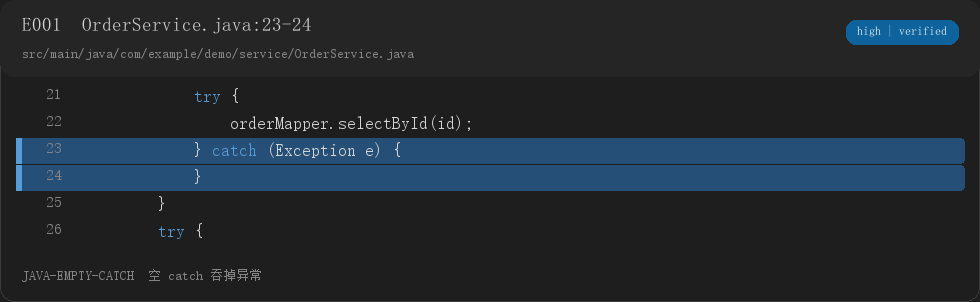

# Project Xray

**你简历上写的每个技术点，它先替面试官问一遍。每个问题都带 `文件:行号` 和代码截图。**

Project Xray 是一个面向 **Java / Spring Boot** 项目的证据化面试准备工具。它不是让 LLM 凭空编面试题，而是：

1. 静态扫描代码，提取可验证的信号
2. 生成 IDE 风格代码证据图
3. 按题目层级输出完整答案、追问和修改建议
4. 校验报告，检查证据、截图和答案结构

适合准备项目面试、核验简历技术点，也适合初学者读懂自己的课程设计。



## 为什么做这个

常见的项目面试工具会生成听起来正确、但无法对应代码的答案。Project Xray 的原则是：

> **先有代码证据，再有问题和答案。**

每条高风险问题都必须能回到：

```text
[E004] src/main/java/.../OrderService.java:20-25
```

没有证据的内容不会被包装成项目事实。

## 快速开始

### 1. 安装

```bash
python -m pip install -e .
project-xray doctor
```

开发环境建议使用虚拟环境：

```bash
python -m venv .venv
# Windows
.venv\Scripts\activate
python -m pip install -e .
```

### 2. 扫描项目

```bash
project-xray scan examples/spring-demo --out .xray/signals.json
```

### 3. 生成代码证据图

```bash
project-xray render .xray/signals.json --out-dir .xray/assets --theme dark
```

### 4. 生成建议修改图

先参考 [examples/fixes.json](examples/fixes.json) 编写自己的 `fixes.json`：

```bash
project-xray fixes .xray/signals.json examples/fixes.json --out-dir .xray/assets
```

### 5. 校验报告

```bash
project-xray validate examples/sample-report.md .xray/signals.json
```

## 输出结构

```text
report.md
signals.json
fixes.json                 # 可选
assets/
  E001.png                 # 当前代码
  E001-after.png           # 建议修改
  manifest.json
  fix-manifest.json
```

## 作为 Codex Skill 使用

先在仓库根目录安装 CLI：

```bash
python -m pip install -e .
```

然后把 `skills/project-xray` 放到 Codex 的 skills 目录，或者创建目录链接：

```powershell
New-Item -ItemType Junction `
  -Path "$env:USERPROFILE\.codex\skills\project-xray" `
  -Target "D:\path\to\project-xray\skills\project-xray"
```

然后在 Codex 中使用：

```text
$project-xray 扫描 D:\path\to\your-project，输出到 D:\project-xray-runs\my-project。
目标岗位是 Java 后端开发，请生成带完整答案、代码截图和修改建议的面试报告。
```

## 报告长什么样

每道题固定包含：

- 题目标题和层级：`[重点]` / `[普通]` / `[延伸]`
- 代码证据图
- `[E###] 文件:行号`
- 30 秒口述版
- 完整解释
- 至少一个追问及完整回答
- 需要补的基础
- 自测任务

重点题优先展示，普通题保持完整，延伸题只留线索，不为了凑数写空话。

## 当前支持

- Java / Spring Boot
- Maven / Gradle 项目结构识别
- MyBatis / MyBatis-Plus / MySQL / Redis / JWT 等常见技术栈
- 静态信号：异常吞掉、循环查库、事务内 RPC、硬编码密钥、日志泄露、缓存失效、权限候选等
- IDE 风格 PNG 代码卡
- Markdown 报告校验

## 安全边界

- 只读扫描，不执行项目代码
- 不安装项目依赖
- 不上传源码
- 密码、secret、token 在扫描片段中脱敏
- 建议修改图明确标记为 `after fix`，不会伪装成项目原有代码

## 已知限制

- 第一版只支持 Java / Spring Boot
- 规则是静态启发式，`likely` / `uncertain` 需要人工核实
- SQL 索引分析依赖仓库内可解析的 `CREATE TABLE` DDL
- 真实 IDEA 截图不是必需项；默认使用自动生成的代码卡
- LLM 生成的通用知识仍需人工复核

## 开发与测试

```bash
python -m unittest discover -s tests -v
```

贡献前请阅读 [CONTRIBUTING.md](CONTRIBUTING.md)。

## License

MIT. See [LICENSE](LICENSE).
