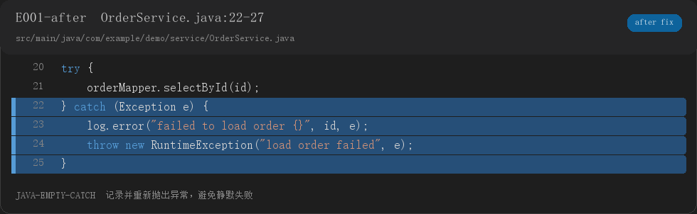

# Project Xray

**你简历上写的每个技术点，它先替面试官问一遍。每个问题都带 `文件:行号` 和代码截图。**

Project Xray 是一个面向 **Java / Spring Boot** 项目的证据化面试准备工具。它不靠 LLM 凭空编题，而是：

1. 静态扫描项目，提取可验证的代码信号
2. 生成 IDE 风格代码截图
3. 输出 30 秒口述版、完整解释、追问回答和修改建议
4. 校验报告，确保每道题都有代码证据

> 适合准备项目面试，也适合初学者读懂自己的课程设计。




## 5 分钟试一下

```bash
python -m pip install -e .
project-xray doctor
project-xray scan examples/spring-demo --out .xray/signals.json
project-xray render .xray/signals.json --out-dir .xray/assets
project-xray fixes .xray/signals.json examples/fixes.json --out-dir .xray/assets
project-xray validate examples/sample-report.md .xray/signals.json
```

示例报告：[examples/sample-report.md](examples/sample-report.md)

## 为什么不是又一个 AI 面试题生成器

普通工具会给你：

```text
MySQL 索引原理是什么？
Redis 为什么快？
```

这些问题听起来正确，但和你的项目没有关系，面试官一追问就容易露馅。

Project Xray 会给你：

```text
Q1. 这个订单处理循环为什么逐条查询？
证据：[E004] OrderService.java:20-25
代码截图：assets/E004.png
30 秒回答：……
完整解释：……
追问：如果 ID 列表很大，批量查询怎么做？
```

每条结论都能回到具体代码。没有证据的内容，不会被包装成项目事实。

## 你会得到什么

每道重点题包含：

- 题目标题和层级：`[重点]` / `[普通]` / `[延伸]`
- 当前代码截图
- 可选的建议修改图
- `[E###] 文件:行号`
- 30 秒口述版
- 完整解释
- 至少 2 个追问及完整回答
- 需要补的基础
- 一个可执行的代码自测

## 两种使用模式

### 面试模式

适合面试前速查：

- 30 秒口述版
- 2—3 个追问
- 代码证据图
- 简历声明核验

### 学习模式

适合初学者和刚做课程设计的人：

- 代码调用链
- 术语解释
- 为什么这样设计
- 常见错误
- 改前/改后代码
- 自测任务

详细说明：[docs/beginner-mode.md](docs/beginner-mode.md)

## 适合谁

- 准备 Java 后端项目面试
- 简历里写了 Spring Boot、MyBatis、Redis、JWT
- 想看懂自己的项目里哪些地方会被追问
- 正在摸黑学 Java，希望有人能从代码出发带自己理解项目

## 不适合谁

- 想背通用八股题
- 想要全自动修改代码
- 非 Java / Spring Boot 项目
- 希望工具替你编造项目经历和线上指标

## 当前支持

- Java / Spring Boot
- Maven / Gradle 项目结构识别
- MyBatis / MyBatis-Plus / MySQL / Redis / JWT 等常见技术栈
- 静态信号：异常吞掉、循环查库、事务内 RPC、硬编码密钥、日志泄露、缓存失效、权限候选等
- IDE 风格 PNG 代码卡
- 改前 / 改后建议图
- Markdown 报告和结构校验

## Codex Skill

这个仓库同时包含一个 Codex Skill：

```text
skills/project-xray/
```

安装 CLI 后，把它放到 Codex 的 skills 目录，或者创建目录链接：

```powershell
New-Item -ItemType Junction `
  -Path "$env:USERPROFILE\.codex\skills\project-xray" `
  -Target "D:\path\to\project-xray\skills\project-xray"
```

然后在 Codex 里：

```text
$project-xray 扫描 D:\path\to\your-project，输出到 D:\project-xray-runs\my-project。
我是一个正在学 Java 的初学者，请生成带完整答案、代码截图、追问和自测的学习版报告。
```

## 输出结构

```text
report.md
signals.json
fixes.json                 # 可选
assets/
  E001.png                 # 当前代码
  E001-after.png           # 建议修改
  manifest.json
  fix-manifest.json
```

## 安全边界

- 只读扫描，不执行项目代码
- 不安装项目依赖
- 不上传源码
- 密码、secret、token 在扫描片段中脱敏
- 改后代码明确标记为建议，不会伪装成项目原有代码

## 已知限制

- 目前只支持 Java / Spring Boot
- 规则是静态启发式，`likely` / `uncertain` 需要人工核实
- SQL 索引分析依赖仓库内可解析的 `CREATE TABLE` DDL
- 默认生成 IDE 风格代码卡，不要求真实 IDEA 截图
- 通用知识仍需人工复核

## 开发与测试

```bash
python -m unittest discover -s tests -v
```

贡献前请阅读 [CONTRIBUTING.md](CONTRIBUTING.md)。

## 路线图

- 更准确的事务、调用链和权限规则
- 更强的初学者学习模式
- HTML 报告和卡片导出
- 多模块 Maven / Gradle 支持
- 更多项目类型

## 写在最后

这个项目最初的想法很简单：

> 我也是摸黑学的。如果当时有人能把我的项目代码变成一个个“面试官会问什么”，可能会少走很多弯路。

如果你也正在摸黑学 Java，希望它能帮你少卡住一次。

如果它确实帮到了你，欢迎点一个 Star；更欢迎你提一个真实的误报或漏报 Issue。

## License

MIT. See [LICENSE](LICENSE).
