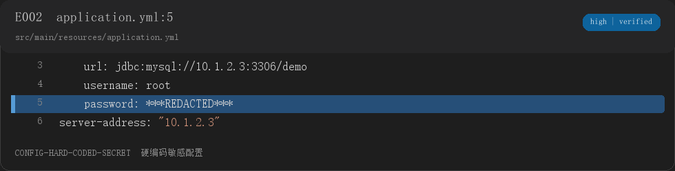
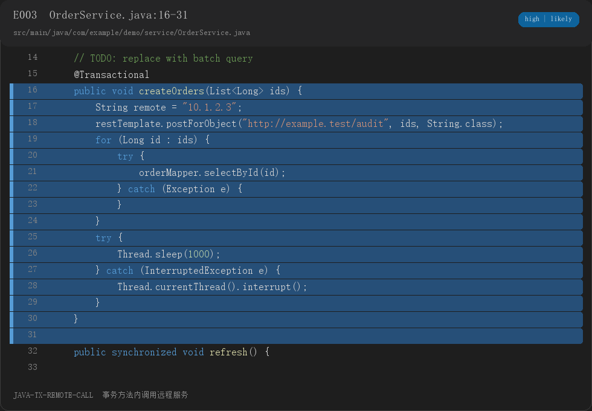
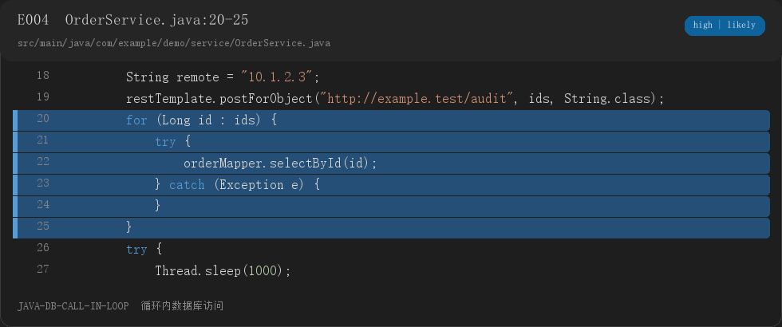

# demo-service 项目 X 光报告

> 扫描版本：`fixture-worktree`
> 扫描范围：`tests/fixtures/java-spring-demo`

## 0. 面试速览

- 一句话画像：Maven + Spring Boot Web + MyBatis + MySQL 的 Java 服务，包含订单服务与数据访问层。
- 最值得讲的 3 个点：异常处理边界、事务与远程调用边界、循环内数据访问。
- 最需要先核实的 2 个风险：硬编码密码、空 catch。

## 1. 项目画像

- 项目名称：demo-service
- 技术栈：Maven、Spring Boot Web、MyBatis、MySQL
- 代码规模：Java 主代码 2 个文件，约 46 行。
- 一句话架构：Controller/Service/Mapper 分层尚未完整出现，当前样例主要体现 Service 与 Mapper 两层。

## 2. 证据化风险与可讲点

### F1. 空 catch 吞掉异常

- 证据：[E001] `src/main/java/com/example/demo/service/OrderService.java:23-24`
  
- 现象：`catch` 块为空，异常被直接吞掉。
- 可能的影响：上层可能无法感知单条订单处理失败，数据状态可能与调用方认知不一致。
- 置信度：`verified`
- 可能的形成路径：仅凭代码无法确认，需本人确认是否为了跳过坏数据而临时忽略异常。
- 正确做法：至少记录上下文并按业务决定重新抛出、告警或补偿；不要用空 catch 静默失败。
- 面试讲法：先说明这里捕获了什么异常，再说明为什么不能让异常消失，最后给出补偿或告警方案。

### F2. 硬编码敏感配置

- 证据：[E002] `src/main/resources/application.yml:5-5`
  
- 现象：配置文件中出现字面量密码字段，值已由扫描器脱敏。
- 可能的影响：凭据进入版本库后可能被复制或误用。
- 置信度：`verified`
- 可能的形成路径：可能是本地演示配置，需本人确认是否为真实凭据。
- 正确做法：迁移到环境变量或密钥管理服务，并轮换已提交的真实凭据。
- 面试讲法：重点讲配置分层、密钥管理和轮换流程，不要把演示密码当成项目亮点。

### F3. 事务方法内调用远程服务

- 证据：[E003] `src/main/java/com/example/demo/service/OrderService.java:16-31`
  
- 现象：`@Transactional` 方法内出现 `restTemplate` 远程调用。
- 可能的影响：事务持有时间可能被远程调用拉长，外部调用成功而数据库回滚时可能产生不一致。
- 置信度：`likely`
- 可能的形成路径：需核实远程调用是否应在事务提交后执行。
- 正确做法：把远程调用移出事务，使用事务提交后事件、消息或补偿机制保证最终一致性。
- 面试讲法：先讲事务边界，再讲外部副作用与回滚不一致，最后讲幂等和补偿。

### F4. 循环内数据库访问

- 证据：[E004] `src/main/java/com/example/demo/service/OrderService.java:20-25`
  
- 现象：循环体内调用 `orderMapper.selectById`。
- 可能的影响：数据量增大时可能产生 N+1 查询。
- 置信度：`likely`
- 可能的形成路径：可能是先拿 ID 列表再逐条补详情，需本人确认循环规模。
- 正确做法：优先批量查询、一次 join 或增加缓存；同时确认是否已有批量接口。
- 面试讲法：先讲当前循环访问方式，再讲批量查询和 join 的取舍，最后说如何用日志或监控验证查询次数。

## 3. 面试题三档

### Q1. [重点] 项目细节题：这个订单处理循环为什么逐条查询？

- 证据：[E004] `src/main/java/com/example/demo/service/OrderService.java:20-25`
- 为什么会问：面试官看到循环内数据库访问会关心数据规模、实现原因和改造方式。
- 30 秒口述版：项目里当前是在循环内逐条调用 `orderMapper.selectById`。如果订单量不大，这样写最简单；但数据量增长后会产生 N+1 查询，所以我会优先改成批量查询或一次 join。
- 完整解释：当前代码先遍历订单 ID，再对每个 ID 单独访问数据库。这样查询次数会随订单数量线性增长，数据库压力也会随数据量放大。改造时要先确认是否存在 `selectBatchIds` 或批量 Mapper 方法，同时处理 SQL 参数上限、内存占用和返回顺序。
- 面试官追问：
  - 追问 1：如果 ID 列表很大，批量查询怎么做？
    完整回答：可以按固定大小分批查询，再在内存中按原顺序组装结果，避免单条 SQL 参数过多。
  - 追问 2：为什么不一定直接改成 join？
    完整回答：join 适合强关联查询，但如果订单详情来自多个服务或需要单独缓存，批量查询和组装更容易控制边界。
- 你需要补的基础：N+1 查询、批量查询、SQL 参数上限、join 与多次查询的取舍。
- 自测：把循环内查询改成批量查询，记录改造前后的 SQL 执行次数。

### Q2. [普通] 技术深度题：为什么这个事务方法里不建议直接调用远程服务？

- 证据：[E003] `src/main/java/com/example/demo/service/OrderService.java:16-31`
- 为什么会问：事务边界和外部调用一致性是后端常见追问。
- 30 秒口述版：代码里事务方法内包含远程调用。远程调用会拉长事务持有时间，而且外部副作用不能随数据库事务一起回滚，所以更稳妥的是把远程调用放到事务提交后，并设计幂等和补偿。
- 完整解释：数据库事务只能控制本地数据库操作，无法控制 HTTP 或消息系统。远程调用成功后如果本地事务回滚，就会出现外部系统已经成功、本地状态未提交的不一致；反过来，远程调用失败也会影响事务时长和连接占用。
- 面试官追问：
  - 追问 1：如果远程调用失败，订单状态怎么处理？
    完整回答：可以把远程调用改成事务提交后的事件或消息，并记录调用状态；失败时通过重试、补偿或人工处理恢复。
- 你需要补的基础：事务边界、最终一致性、幂等、补偿事务。
- 自测：把远程调用移到事务方法外，说明重试和补偿分别放在哪里。

### Q3. [普通] 场景设计题：如果订单量增长，你先改哪一段？

- 证据：[E004] `src/main/java/com/example/demo/service/OrderService.java:20-25`
- 前提假设：假设订单量增长导致循环查询次数上升，实际指标需要通过监控确认。
- 为什么会问：面试官想看你是否能从代码定位瓶颈，而不是只会说加缓存。
- 30 秒口述版：我会先改循环查询，把逐条查询变成批量查询；然后检查远程调用是否在事务内。最后用查询次数、事务耗时和错误率验证改造效果。
- 完整解释：先处理最明确的 N+1 查询，再处理事务和远程调用的边界。缓存只能放在确认数据访问模式之后，否则可能把不一致问题藏起来。改造顺序应是先减少无效查询，再考虑异步化和缓存。
- 面试官追问：
  - 追问 1：为什么不是先加 Redis？
    完整回答：如果当前瓶颈是循环查库，先加缓存会增加一致性和失效逻辑的复杂度；批量化通常更直接，也更容易验证。
- 你需要补的基础：性能瓶颈定位、N+1、缓存一致性、事务耗时。
- 自测：列出改造前后的查询次数、事务耗时和失败率三个观测指标。

## 4. 八股映射卡

### C1. 事务与外部调用

- 项目锚点：[E003] `src/main/java/com/example/demo/service/OrderService.java:16-31`
- 三句话：
  1. 项目里在订单处理方法上使用了 `@Transactional`，并在方法内调用了远程服务。
  2. 本地事务无法覆盖远程服务的副作用，远程调用还会拉长事务持有时间。
  3. 如果继续追问，我会先确认远程调用是否已移出事务，以及是否有幂等和补偿。
- 追问陷阱：远程调用成功后数据库回滚，订单状态如何补偿？

## 5. 反问面试官

1. 团队目前如何划分数据库事务和外部调用的边界？
2. 订单类接口是否有关键查询次数和事务耗时的监控？
3. 线上配置和密钥通常通过什么流程发布和轮换？

## 6. 简历声明核验

未提供简历描述。

---

本次共发现 4 个可讲点，2 个高危坑，建议优先准备第 3、4 题。
